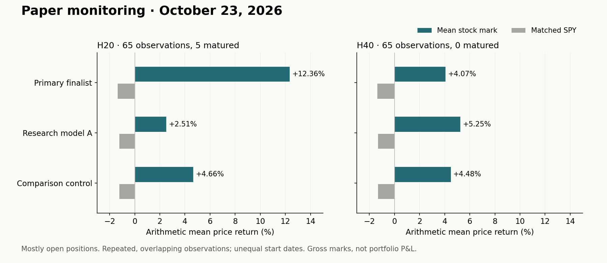
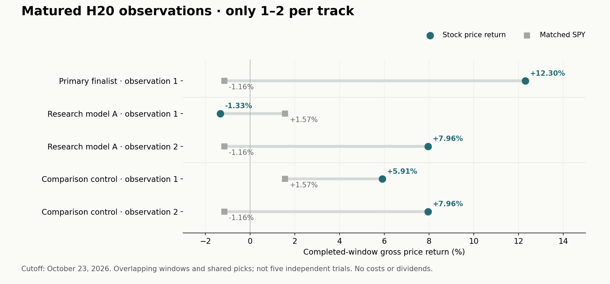

# Paper-monitoring update — October 23, 2026

**Early, incomplete paper observations. No model promotion or trading recommendation.** The Primary finalist remains the current production-labelled version; this designation describes its operational role, not validated superiority. Research model A is experimental and Comparison control is for evaluation only.

The Primary finalist has **one matured H20 observation: +12.30% versus −1.16% for SPY**. Most observations are still open. There are no matured H40 observations for these three tracks. These records do not establish expected returns or a reliable ranking of models.

## Reading guide

| View | What it answers | Main limitation |
|---|---|---|
| Interim marks below | How recorded observations stand at the cutoff | Most positions are unfinished and holding lengths differ |
| Matured outcomes | What happened over completed holding windows | Only 1–2 H20 observations per track; no H40 maturities |

## 1. Interim marks: most outcomes remain open

| Track | Horizon | Observations | Matured | Distinct tickers | Mean price mark | Mean versus SPY |
|---|---|---|---|---|---|---|
| Primary finalist | H20 | 21 | 1 | 4 | +12.36% | +13.72 pp |
| Primary finalist | H40 | 21 | 0 | 3 | +4.07% | +5.44 pp |
| Research model A | H20 | 22 | 2 | 6 | +2.51% | +3.74 pp |
| Research model A | H40 | 22 | 0 | 8 | +5.25% | +6.57 pp |
| Comparison control | H20 | 22 | 2 | 7 | +4.66% | +5.90 pp |
| Comparison control | H40 | 22 | 0 | 6 | +4.48% | +5.80 pp |

*Figure 1. Average stock and matched-benchmark marks for entered observations. Counts across tracks include overlapping and sometimes identical selections.*

Each observation starts at its recorded next-session open. Open observations are marked to October 23 close; matured observations end at their scheduled exit open. SPY uses the identical interval for each observation. Values are arithmetic means of gross price returns, without dividends, fees or slippage. **They are not realized profits, compounded portfolio returns or returns from the same holding length.**

The Primary finalist has 21 entered observations per horizon, beginning September 25. The two comparison tracks have 22, beginning September 18. Consequently the table above is not a fully paired comparison. On the 21 shared decision dates, Research model A minus Primary finalist averaged **-9.67 percentage points for H20** and **+1.17 points for H40**, using those same incomplete marks.

## 2. Completed windows: the small sample that has matured

| Track | Horizon | Matured observations | Mean price return | Matched SPY | Mean difference |
|---|---|---|---|---|---|
| Primary finalist | H20 | 1 | +12.30% | -1.16% | +13.46 pp |
| Research model A | H20 | 2 | +3.32% | +0.21% | +3.11 pp |
| Comparison control | H20 | 2 | +6.93% | +0.21% | +6.73 pp |

*Figure 2. All five matured H20 track-observations, shown individually rather than hiding the sample size behind a mean. These are overlapping observations, including shared picks.*

These samples contain repeated selections and overlapping holding windows. Each track has only one non-overlapping matured H20 window under the archive's counting rule, which is not an independence certificate. No confidence interval or performance-superiority claim is supported yet. A single favourable outcome is not validation.

## 3. Interpretation and next checkpoint

- Outcomes come from saved forward observations. Entries, marks and maturities are hypothetical paper prices, not brokerage executions.
- Most outcomes remain unfinished; results can reverse before maturity. A small number of distinct stocks drives many repeated observations.
- This update introduces no model change, promotion, allocation change or instruction to trade. The next useful evidence is additional matured outcomes with appropriate dependence and concentration checks.
- The older archived comparison is omitted. No model implementation, features, parameters, scores, training details, private positions or source datasets are included.

[Browse daily signals and the outcome archive](https://hansun103.github.io/AI-Driven-Portfolio-Research-Showcase/). The archived first-five checkpoint elsewhere in the README remains a separate historical sample.
